<div align="center">

# Swarm Proving Ground

### Every crash in the field is a test you didn't run.

**Agentic failure discovery for drones and ground robots, before the first field test.**

A swarm of parallel Claude Agent SDK agents hunts a vehicle's failure modes along a real mission route, through a full year of real hourly weather.
Their verified findings seed a zoomable proving ground of more than one million Monte-Carlo-tested environments, and any cell opens into a 3D replay of the real city at that exact hour.


<a href="https://www.youtube.com/watch?v=YUvj0v6jV14">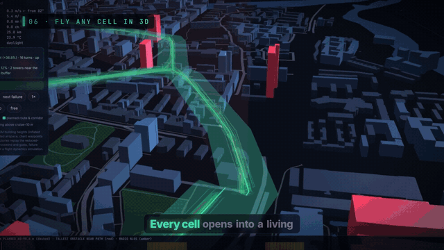</a>

**[▶ Watch the 2-minute narrated demo on YouTube](https://www.youtube.com/watch?v=YUvj0v6jV14)** ([MP4](docs/media/demo.mp4)) · [Architecture](docs/ARCHITECTURE.md) · [Workflow](docs/WORKFLOW.md) · [Roadmap](docs/ROADMAP.md)

| 24 | 8,760 | 1,048,576 | 16.8M | 64 |
|:---:|:---:|:---:|:---:|:---:|
| parallel Claude agents | hours of real weather | environment cells | simulated flights | 3D trial replays per cell |

</div>

---
<div align="center">
  <a href="https://www.youtube.com/watch?v=YUvj0v6jV14">
    
  </a>
  <br/>
  <a href="https://www.youtube.com/watch?v=YUvj0v6jV14">
    
  </a>
</div>

## Why it exists

Drones and robots are moving into delivery, agriculture, inspection and disaster response. Most of their failures happen at the edges of the operating envelope: the gust front on the return leg, the cold-soaked battery at 06:00 in January, the IP43 enclosure in a 9 mm/h downpour, the tower that a straight-line route cuts through, the loaded robot on a wet 18° slope.

Field testing finds those edges slowly, expensively, and only in the weather you happen to get. **You test in the conditions you get, not the storm that grounds your fleet.** Swarm Proving Ground inverts that workflow:

1. **Describe the machine.** Real engineering parameters: thrust, battery chemistry, IP rating, payload, sensors, temperature limits.
2. **Bring the real mission.** Upload a QGroundControl `.plan`, GeoJSON, KML or GPX route, or pick a demo route. The real city is pulled in: building heights, terrain, airspace and an occupancy proxy for people underneath.
3. **Plan it in 3D.** An A\* planner searches around towers, over low roofs and out of restricted airspace, keeping every client waypoint.
4. **Load the real environment.** 8,760 hours of measured weather for that exact route.
5. **Let an agent swarm attack it.** 20–30 specialist agents search the weather record, the route and the physics model in parallel for minimal, realistic failure scenarios. Every claimed failure is re-run with 400 fresh trials; unreproducible claims are rejected.
6. **Stress the whole envelope.** Over a million environment cells (every departure time of the year, flown along the route) are Monte-Carlo-tested and streamed live to the browser.
7. **Fly any cell in 3D.** Zoom from a million worlds down to one, and replay its 64 flights through the real buildings in that hour's wind, rain, fog and light.
8. **Close the loop.** Engineering fixes are proposed per failure mode, re-simulated, and quantified as pass-rate deltas.

> Results are **engineering screening** from reduced-order models fed with measured weather and open map data. They rank risks and compare designs; they are not flight certification or regulatory approval. See [Honesty notes](#honesty-notes).

## Highlights

| | |
|---|---|
| **Two platforms** | Multirotor drones (4/6/8 rotors) and wheeled/tracked/legged ground robots, each with a full engineering parameter schema. |
| **Real mission routes** | QGroundControl `.plan`, GeoJSON, KML and GPX upload, or Canary Wharf demo routes. OpenStreetMap buildings, roads and water; Copernicus GLO-30 surface model; openAIP airspace; people occupancy proxy. |
| **3D obstacle-avoiding planner** | A\* over a 20 m city raster with 20 m altitude layers: lateral and vertical building clearance, restricted airspace avoidance, an altitude ceiling, client waypoints preserved, string-pulled smoothing. |
| **Real weather** | Hourly wind, direction, gusts, rain, snow, temperature, humidity, pressure and cloud for the last 12 months (Open-Meteo historical archive, ERA5), with altitude wind shear. |
| **Parallel agent swarm** | Up to 30 concurrent `claude_agent_sdk` agents, each a domain specialist (gust-front hunter, cold-soak battery chemist, link-loss analyst, tip-over analyst...), using in-process MCP tools. |
| **Grounded, verified findings** | Agents must cite real weather hours and pass a 400-trial re-verification gate. No hallucinated crashes. |
| **Million-cell proving ground** | 1024² = 1,048,576 cells by default, 16 trials each (16.8M simulated missions), streamed as binary tiles onto a zoomable canvas from ×0.2 to ×400. On a route, each cell is one real departure time. |
| **3D cell replay** | Any cell opens into an extruded 3D city (deck.gl): A/B markers, straight-line ghost vs planned route, avoided towers, airspace volumes, 64 trial trajectories, wind, rain/snow, fog, day/night lighting, failure markers and a per-flight result card. |
| **Design loop** | Per-failure-mode engineering fixes with before → after pass rates; one click re-runs the whole pipeline on the improved design. |
| **Every LLM call through Mubit.ai** | The agent swarm and the flight-ops go/no-go review call Claude only via the [Mubit.ai](https://docs.mubit.ai) proxy, which records calls, groups them into recurring tasks and trains task-specific adapters from rated replies. There is no direct-API path. |
| **Flight-ops review (recurring Mubit task)** | After each run a reviewer gives GO / GO WITH CONDITIONS / NO-GO with reasons, crew conditions and the fix to apply first, shows the Mubit request id, and compares against the last review of the same route. |
| **Offline mode** | Without `MUBIT_API_KEY` (or with `SWARM_BACKEND=mock`) labelled deterministic agents use the same tool protocol and make no LLM calls; the review then reports that Mubit is not configured. |

## See it

<table>
<tr>
<td width="50%">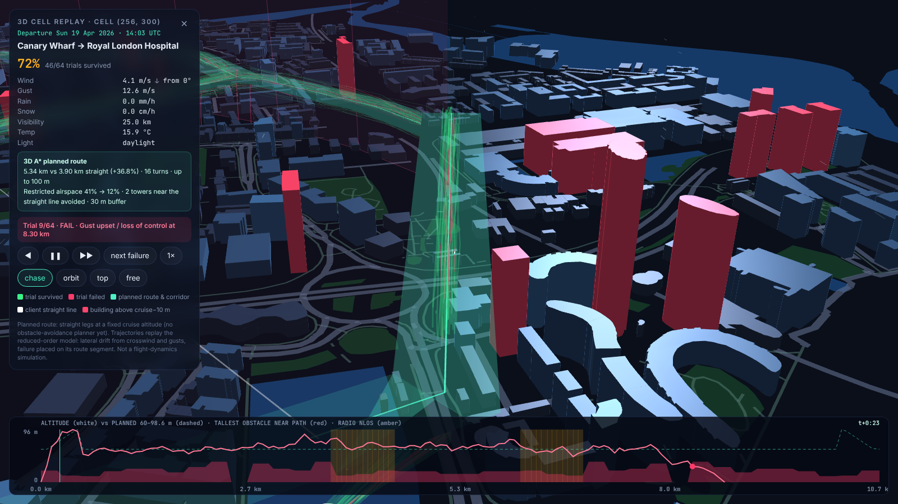<br/><sub><b>3D planned route.</b> The A\* route (teal) bends around the towers that the client's straight line (white ghost) would cut through.</sub></td>
<td width="50%">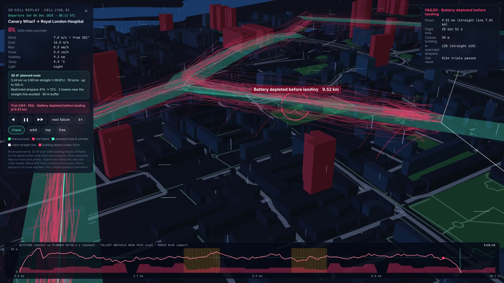<br/><sub><b>Failure, pinned to the route.</b> 64 night-time trials; the marker shows exactly where and why: battery depleted at 9.52 km.</sub></td>
</tr>
<tr>
<td>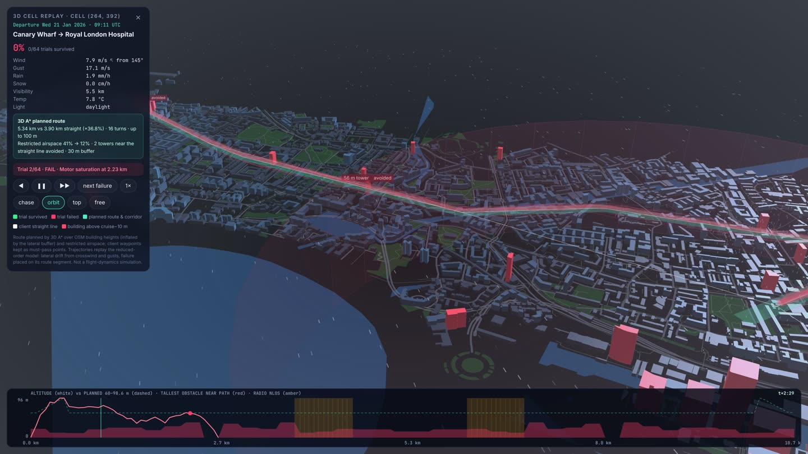<br/><sub><b>Driving rain.</b> 1.9 mm/h with 17 m/s gusts, 21 Jan 09:11.</sub></td>
<td>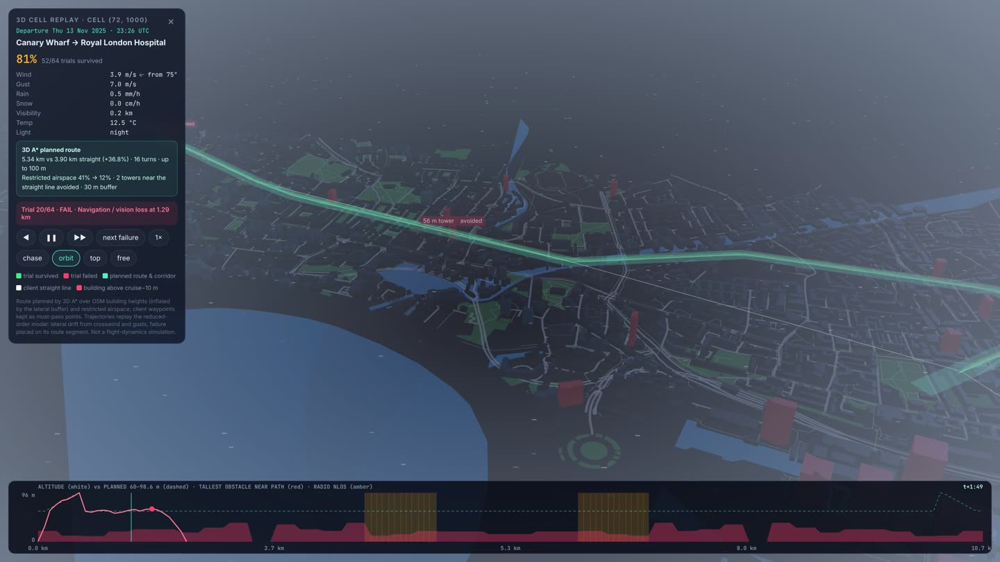<br/><sub><b>Fog.</b> About 200 m visibility, 13 Nov 23:26: the towers vanish.</sub></td>
</tr>
<tr>
<td>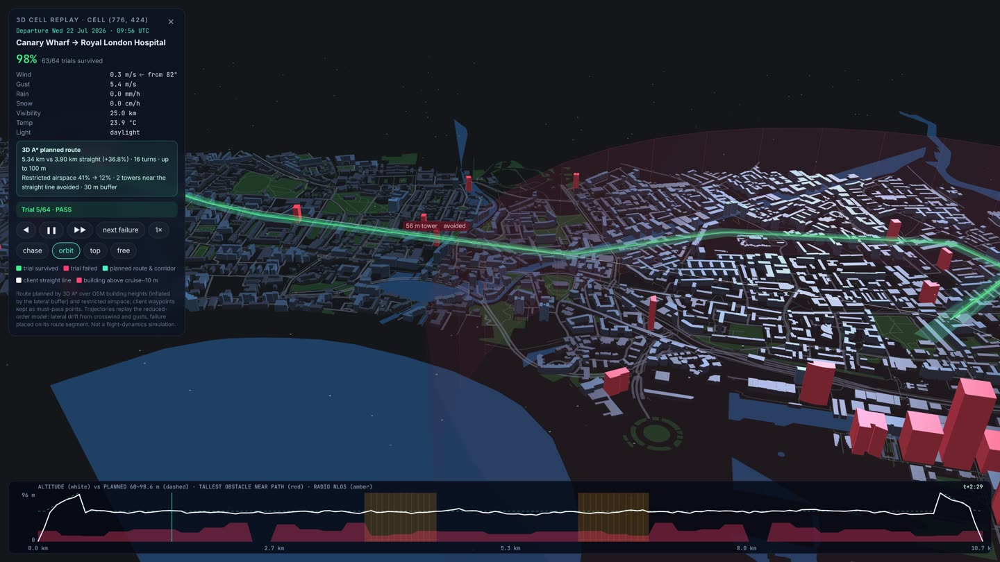<br/><sub><b>Clear day.</b> 98% of the 64 trials survive inside the planned corridor.</sub></td>
<td>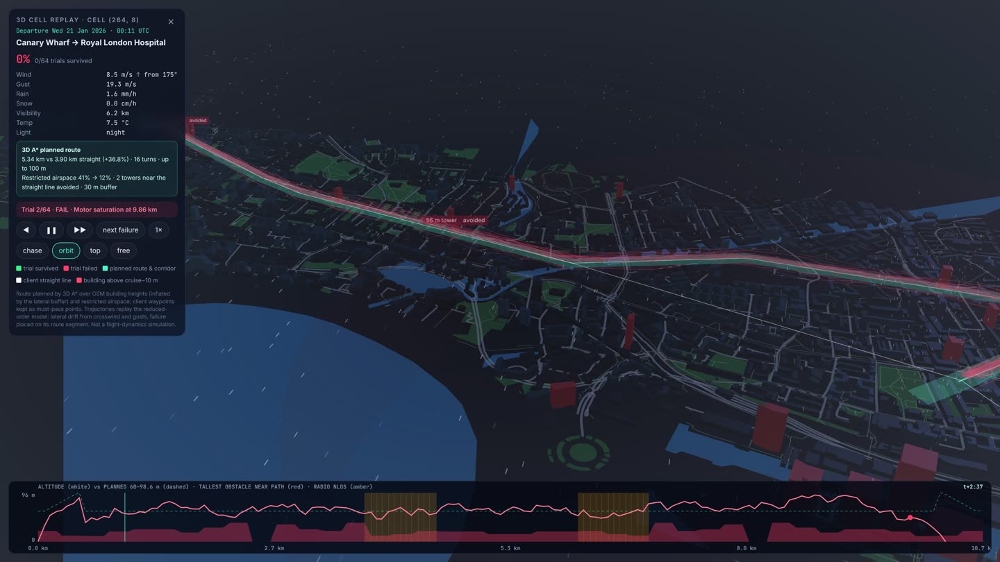<br/><sub><b>Night flight.</b> 7.5 °C and 19 m/s gusts at 00:11 on 21 Jan, on a cold battery.</sub></td>
</tr>
<tr>
<td>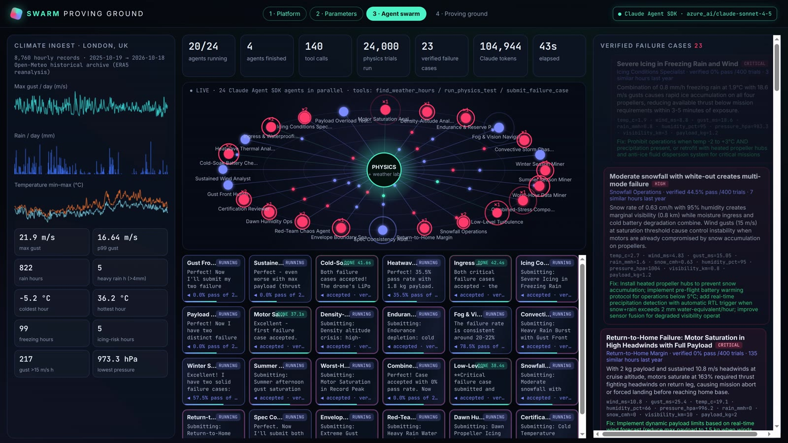<br/><sub><b>Agent swarm.</b> 24 live agents, tool-call particles, climate year, verified-case feed.</sub></td>
<td>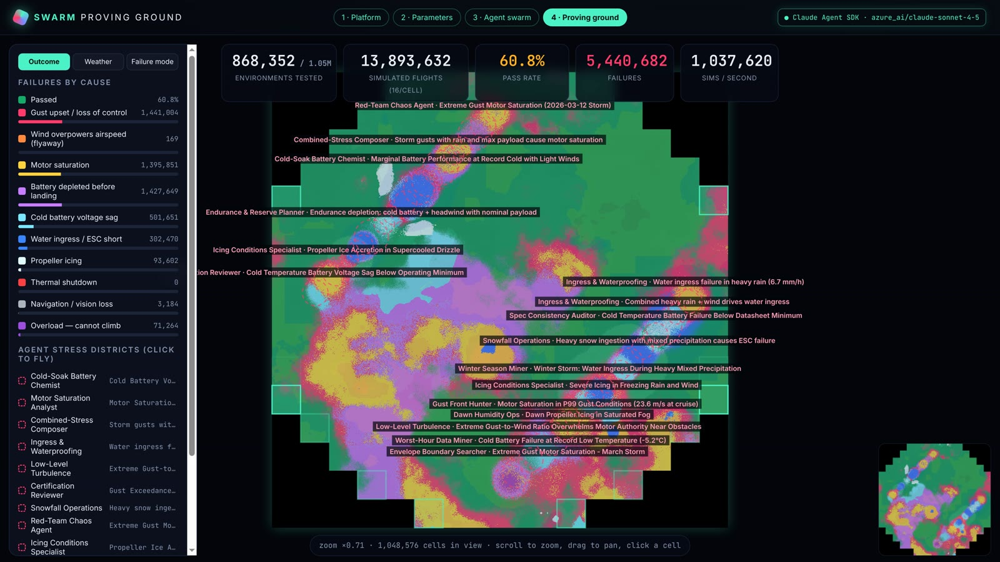<br/><sub><b>Proving ground.</b> 1,048,576 environment cells, filled live as tiles stream in.</sub></td>
</tr>
<tr>
<td>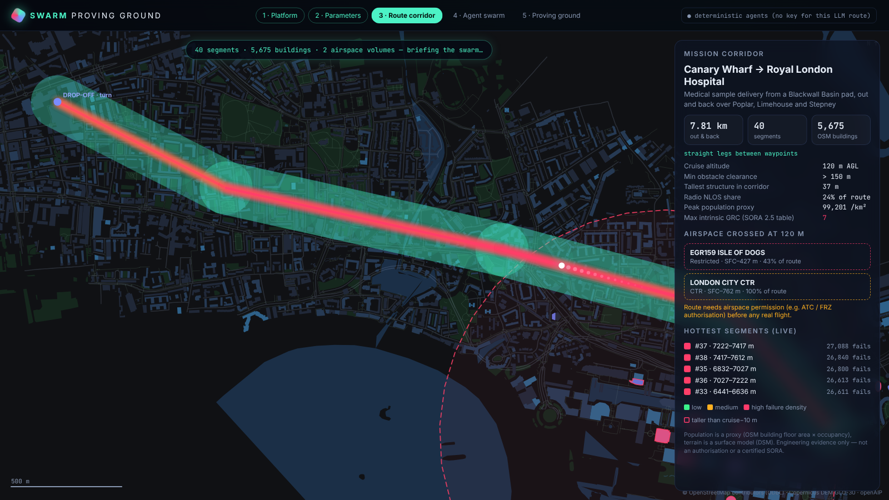<br/><sub><b>Route corridor.</b> OSM buildings by height, airspace, and live failure heat along the route.</sub></td>
<td>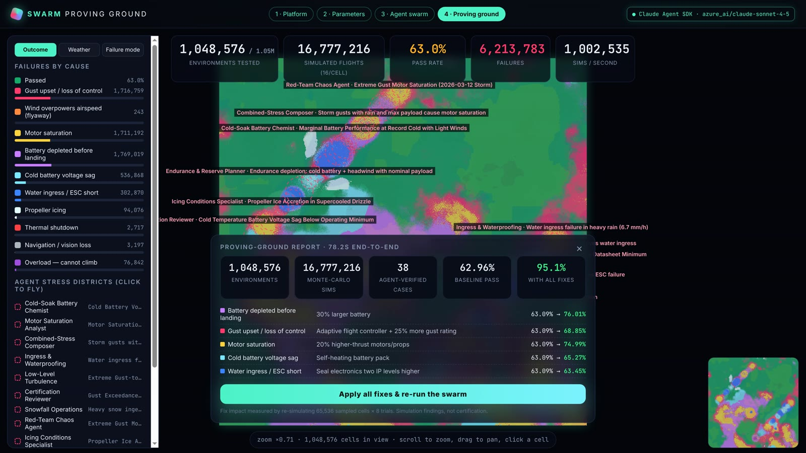<br/><sub><b>Engineering report.</b> Failure modes, proposed fixes and measured pass-rate gains.</sub></td>
</tr>
<tr>
<td>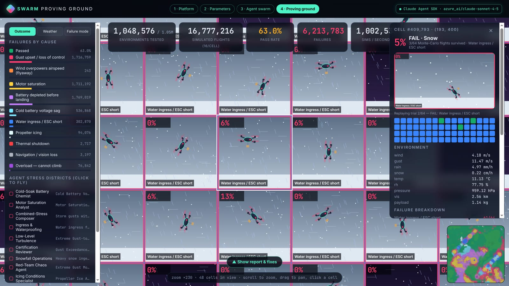<br/><sub><b>Cell inspector.</b> Per-cell scene, 64-trial replay, margins and failure modes.</sub></td>
<td>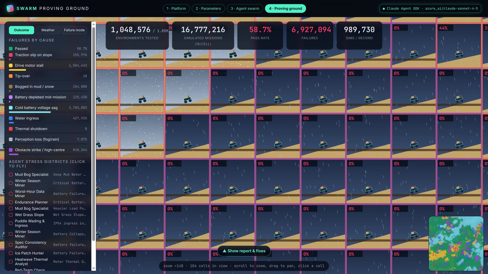<br/><sub><b>Ground robots.</b> Slope, mud, traction, tip-over and obstacle strikes.</sub></td>
</tr>
</table>

## Case study: Canary Wharf → Royal London Hospital

An out-and-back hospital delivery through one of London's densest tower clusters, inside the London City CTR and next to the EGR159 Isle of Dogs restricted area.

| At 60 m cruise | Straight line | 3D planned route |
|---|---|---|
| Distance (A → B) | 3.90 km | 5.34 km (+37%) |
| Time in restricted airspace | 41% | 12% |
| Buildings | 2 towers inside the 30 m buffer | closest building 30 m, both towers avoided |
| Shape | 1 leg | 16 turns, climbs to 100 m where needed, all waypoints kept |

In the demo run, the proving ground found a **66.8% baseline pass rate** across the year; the engineering fixes (30% larger battery, adaptive flight controller, higher-thrust motors, self-heating battery pack and more) lifted it to **95.1% when re-simulated**. At the default 120 m cruise no tower blocks the straight line, so the detour comes only from restricted airspace.

## Architecture

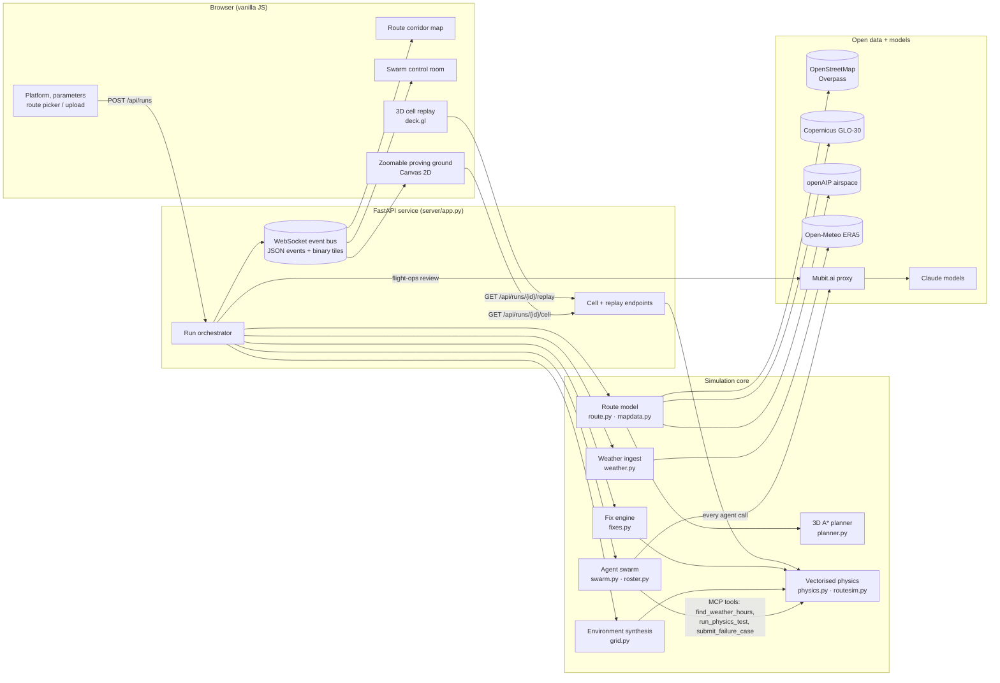

Full component breakdown, event protocol and tile format: **[docs/ARCHITECTURE.md](docs/ARCHITECTURE.md)**.

## Workflow

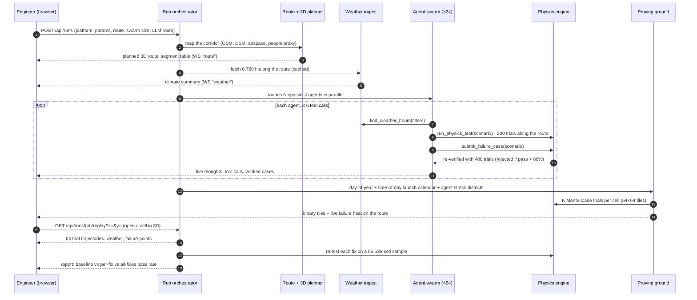

Stage-by-stage detail, agent loop, verification gate and the developer workflow: **[docs/WORKFLOW.md](docs/WORKFLOW.md)**.

## Quick start

```bash
uv sync
uv run uvicorn server.app:app --port 8811
# open http://localhost:8811
```

No key needed to try it: without an LLM key the swarm runs deterministic agents with the same tools. The first route run downloads and caches about 130 MB of map data.

1. Pick **Drone** or **Ground robot** and tune the parameters.
2. Choose a Canary Wharf route or upload your own mission file. For the clearest building avoidance, set cruise altitude to 60 m.
3. Launch, watch the swarm, then click any cell on the proving ground and press **▶ Fly this cell in the 3D city**.

### Configuration

| Variable | Purpose |
|---|---|
| `MUBIT_API_KEY` | Required for live agents. All LLM calls go to `https://api.mubit.ai/anthropic` (override with `MUBIT_BASE_URL`). |
| `SWARM_MUBIT_MODEL` (`claude-sonnet-5-5`), `SWARM_MUBIT_SMALL_MODEL` (`claude-haiku-4-5`) | Models the swarm asks Mubit for. |
| `SWARM_REVIEW_MODEL` (`claude-haiku-4-5`) | Model the flight-ops review asks Mubit for. |
| `SWARM_BACKEND=mock` | Offline deterministic agents: no LLM calls, free, same tool protocol. |
| `SWARM_CONCURRENCY` (30), `SWARM_AGENT_TIMEOUT` (300 s), `GRID_REVEAL_SECONDS` (16) | Swarm concurrency, per-agent timeout, pacing of the live grid fill. |

Planner settings are run parameters on the Parameters screen: `avoid_obstacles` (on), `cruise_altitude_m` (120), `max_altitude_m` (120) and `obstacle_buffer_m` (30).

### Benchmark the swarm

```bash
uv run python scripts/bench_swarm.py --agents 8 --platform drone
```

Runs the swarm only (no grid) through Mubit and writes wall time, per-agent latency, time-to-first-tool, tool-call mix, verified cases, tokens and cost to `data/bench/`.

### Mubit learning loop (flight-ops review)

1. Each finished run sends one review call with the same instructions, so Mubit files them under one task (Mubit console → **Tasks**).
2. Rate the replies in **Requests** (good / bad). Rated-up replies become the task's kept examples; Mubit trains an adapter once it has enough.
3. When the adapter is live, the next review of the same route is answered by it. The report shows the served model, the Mubit request id and how the verdict changed against the previous review of that route (**Ask the reviewer again** re-asks on the same run).

### Route files

Sample client-style missions: [`docs/samples/guys_to_royal_london.plan`](docs/samples/guys_to_royal_london.plan) (QGroundControl) and [`.geojson`](docs/samples/guys_to_royal_london.geojson). Bad files are rejected with a specific message: empty, not JSON/XML, broken JSON (line and column), broken XML, fewer than 2 waypoints, invalid or 0,0 coordinates, over 2 MB, or longer than 60 km.

### API

| Method | Path | Description |
|---|---|---|
| `GET` | `/api/meta` | Platform schemas, site presets, active backend, available LLM routes. |
| `GET` | `/api/routes` | Demo routes and supported mission-file formats. |
| `POST` | `/api/routes/parse` | Parse an uploaded `.plan` / GeoJSON / KML / GPX into waypoints and geofence. |
| `POST` | `/api/runs` | Start a run: `platform`, `params`, `location` or route, `agents`, `grid`, `trials`, `provider`. |
| `WS` | `/ws/runs/{id}` | Replayable event stream: JSON events plus binary 64×64 result tiles. |
| `GET` | `/api/runs/{id}/cell?x=&y=` | Re-simulate one cell with 64 fresh trials and return its forensics. |
| `GET` | `/api/runs/{id}/replay?x=&y=` | Per-trial 3D trajectories, planned route and weather for one route cell. |

## Mission routes

A route run adds a **Route corridor** stage between weather and the swarm:

1. **Corridor mapping** (`server/route.py`, `server/mapdata.py`): OSM features for every map tile the route touches, rasterised to 20 m cells (building heights, people proxy, water, green areas, roads, sensitive sites). Terrain from the Copernicus GLO-30 surface model; airspace from openAIP.
2. **3D planning** (`server/planner.py`): drones get an A\* route over (row, column, altitude layer) that keeps lateral and vertical clearance from buildings, avoids restricted, prohibited and danger areas where it can, and keeps every waypoint. Ground robots are routed on OSM footways with Dijkstra.
3. **Per-segment profile**: length, heading, obstacle clearance, urban-canyon index, radio line-of-sight from the pad, population proxy and SORA 2.5 intrinsic GRC, airspace crossed, slope, surface and crossings.
4. **Route-aware swarm**: every agent gets the segment table, and its physics tests fly the route with `wind_dir_deg` and `hour_of_day`.
5. **Launch calendar plane** (`server/routesim.py`): x = day of the weather year, y = time of day. Each cell is a real departure flown along the corridor, with headwind/crosswind energy per leg, gusts amplified in urban canyons, lateral deviation versus corridor width, obstacle conflict, C2 link loss, and pedestrian and office-occupancy profiles by hour.
6. **Failure heat and 3D replay**: each failed trial is attributed to a route segment, and any cell can be replayed in 3D. The report adds expected people struck per million flights (proxy), max intrinsic GRC and the airspace crossed.

| Demo route | Platform | Length | Finding (mock-agent run, 120 m cruise) |
|---|---|---|---|
| Canary Wharf → Royal London Hospital (out & back) | drone | 7.8 km | 77.7% pass; inside London City CTR and EGR159 Isle of Dogs; 24% of the route is radio NLOS from the pad |
| Isle of Dogs inspection loop | drone | 4.8 km | ~32% pass; obstacle conflict next to the South Quay towers dominates |
| Canary Wharf stn → Crossharbour (out & back) | robot | 4.1 km on OSM footways | ~91% pass; 21 road crossings |
| Canary Wharf → Mudchute Park | robot | 1.5 km | park paths and grass at the end |

<table>
<tr>
<td width="50%">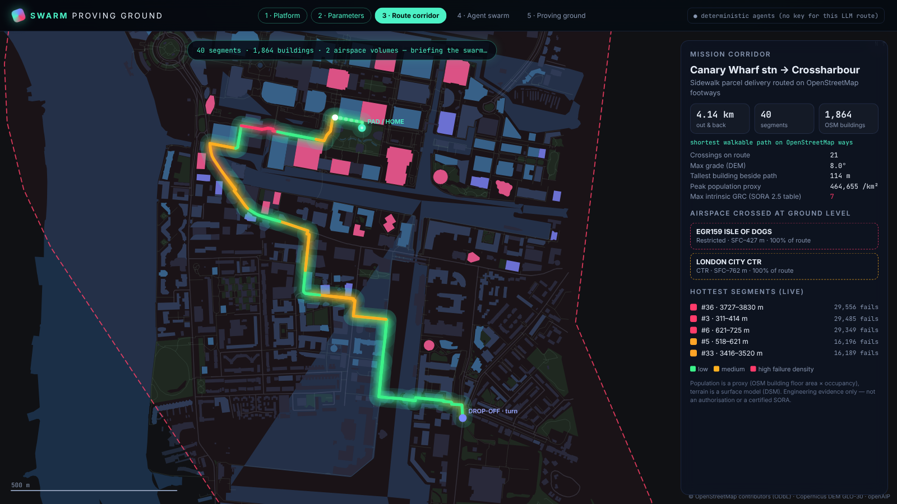<br/><sub><b>Robot corridor.</b> Sidewalk routing, crossings and slope.</sub></td>
<td width="50%">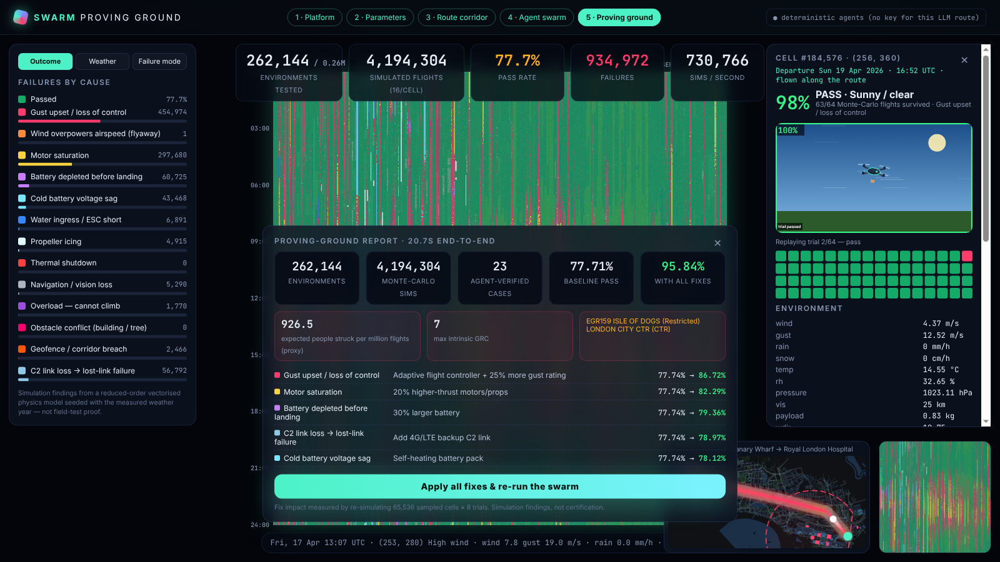<br/><sub><b>Launch calendar.</b> Every departure time of the year along the route.</sub></td>
</tr>
</table>

## Roadmap

Weather and mission routes are the first environmental layers. The same agent → verify → grid → fix pipeline is designed to take more, each adding new dimensions to every cell and new tools for the swarm. **Items marked Next or Later are planned and not yet implemented.**

| Phase | Layer | What it adds |
|---|---|---|
| **Shipped** | Weather year | Wind, gusts, shear, rain, snow, icing, heat, cold, pressure, humidity. |
| **Shipped** | LLM routing | Every swarm and review call through Mubit.ai, with adapter training on the recurring tasks. |
| **Shipped** | Mission routes | Demo or uploaded `.plan` / GeoJSON / KML / GPX routes; OSM buildings, trees, roads and water; Copernicus DSM; wind direction; per-leg energy and return reserve. |
| **Shipped** | People, airspace & geofence | Population proxy with SORA 2.5 intrinsic-GRC lookup, openAIP airspace intersection, corridor drift, obstacle conflict, C2 link loss; robot pedestrians, crossings and localisation loss. |
| **Shipped** | 3D planner & cell replay | A\* obstacle- and airspace-avoiding drone routes; 3D city replay of any cell with weather, trajectories and per-flight results. |
| Next | Bring-your-own-test | Client YAML test cases with pass criteria, log-calibrated vehicle models (PX4 `.ulg`, ArduPilot `.bin`, ROS 2 MCAP). |
| Next | Dynamic obstacles | Moving people, vehicles and other aircraft; climb energy in the planner. |
| Later | GNSS / RF degradation | Urban canyon multipath, GPS denial, link loss and lost-link behaviour. |
| Later | Component ageing | Battery cycle fade, motor wear, sensor drift over a fleet's service life. |
| Later | Fleet operations | Multi-vehicle missions, charging logistics, fleet-level availability. |
| Later | SITL / HIL bridge | Export agent-found scenarios to PX4 / ArduPilot SITL and Gazebo for high-fidelity confirmation. |
| Later | Evidence packs | Traceable failure-case reports to support safety cases. |

Design notes for each layer: **[docs/ROADMAP.md](docs/ROADMAP.md)**.

## Repository layout

```
server/
  app.py        FastAPI app: run orchestration, WebSocket event bus, tile streaming, cell + replay endpoints
  swarm.py      Claude Agent SDK swarm, MCP tools, LLM route switch, deterministic fallback agents
  roster.py     specialist agent roles per platform
  weather.py    Open-Meteo ingest, caching, climate summary, hour search
  route.py      mission parsing (.plan/GeoJSON/KML/GPX), corridor profile, demo routes
  mapdata.py    OSM, Copernicus DSM and openAIP fetch, cache and rasterisation
  planner.py    3D A* obstacle- and airspace-avoiding route planner
  routesim.py   launch-calendar simulation along a route, per-trial 3D replays
  physics.py    vectorised reduced-order drone and robot models
  grid.py       environment synthesis, categories, agent stress districts
  platforms.py  parameter schemas, presets, normalisation
  fixes.py      engineering fixes per failure mode
web/            single-page UI (index.html, css/, js/: config, swarm, plane, map, city3d, scenes, main)
scripts/        bench_swarm.py: swarm benchmark (via Mubit); seed_review.py: seeds the Mubit review task
docs/           architecture, workflow, roadmap, screenshots, demo video, samples/ route files
```

## Honesty notes

- Results are **engineering screening** from reduced-order models seeded with measured weather. They rank risks and compare designs; they are not flight certification, an airspace authorisation, a certified SORA or regulatory approval.
- "Simulated flights" counts Monte-Carlo trials of the vectorised model, not full rigid-body simulations. 3D trajectories replay the same reduced-order model (lateral drift from crosswind and gusts).
- The planner treats buildings and airspace as static; climbing costs no extra energy yet. If no feasible path exists it falls back to the straight leg.
- Population is a **proxy** (OSM building floor area × occupancy), not census data. The Copernicus DEM is a surface model, so it includes buildings. openAIP data needs licence confirmation for commercial use.
- Throughput and pass rates shown in the UI are measured live for each run.
- Map data © OpenStreetMap contributors (ODbL). Weather: Open-Meteo (ERA5). Terrain: Copernicus GLO-30. Airspace: openAIP.
