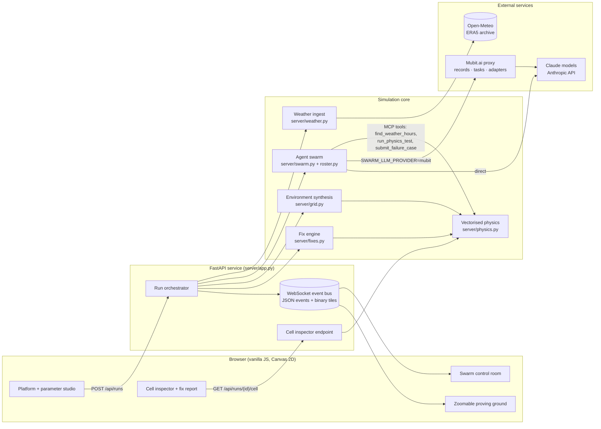
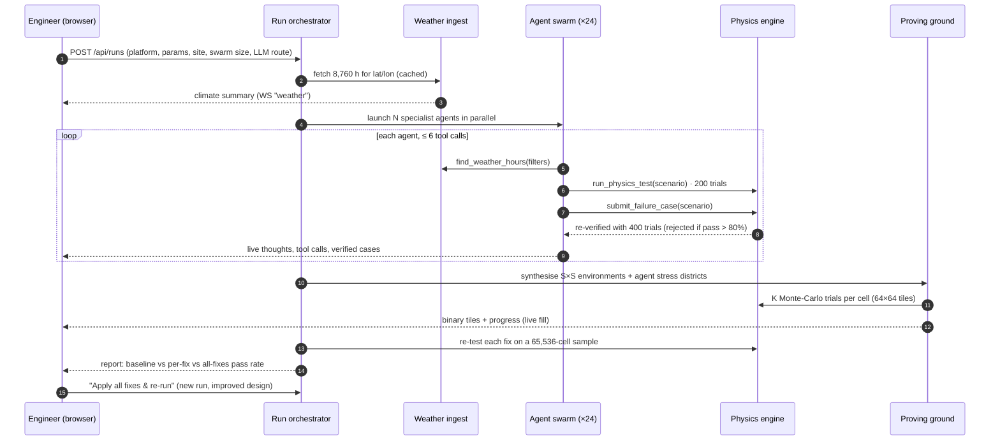

<div align="center">

# Swarm Proving Ground

**Agentic failure discovery for drones and ground robots, before the first field test.**

A swarm of parallel Claude Agent SDK agents hunts a vehicle's failure modes in a full year of real, location-specific weather.
Their findings seed a zoomable proving ground of more than one million Monte-Carlo-tested environments, each one a different world.

`Python 3.12` · `FastAPI` · `Claude Agent SDK` · `MCP tools` · `NumPy` · `WebSocket streaming` · `Canvas 2D` · `Open-Meteo ERA5` · `Mubit.ai`


</div>

---

## Why it exists

Drones and robots are moving into delivery, agriculture, inspection and disaster response. Most of their failures happen at the edges of the operating envelope: the gust front on the return leg, the cold-soaked battery at 06:00 in January, the IP43 enclosure in a 9 mm/h downpour, the loaded robot on a wet 18° slope.

Field testing finds those edges slowly, expensively, and only in the weather you happen to get. Swarm Proving Ground inverts that workflow:

1. **Describe the machine.** Real engineering parameters (thrust, battery chemistry, IP rating, payload, sensors, temperature limits).
2. **Load the real environment.** 8,760 hours of measured weather for the exact operating site.
3. **Let an agent swarm attack it.** 20–30 specialist agents search the weather record and the physics model in parallel for minimal, realistic failure scenarios.
4. **Verify everything.** Every claimed failure is independently re-run with 400 fresh trials. Unreproducible claims are rejected.
5. **Stress the whole envelope.** A grid of up to 2 million environment cells is Monte-Carlo-tested and streamed live to the browser.
6. **Close the loop.** Engineering fixes are proposed per failure mode, re-tested, and quantified as pass-rate deltas.

> Results are **simulation findings** from reduced-order physics fed with measured weather. They rank risks and compare designs; they do not replace flight or field certification. See [Honesty notes](#honesty-notes).

## Highlights

| | |
|---|---|
| **Two platforms** | Multirotor drones (4/6/8 rotors) and wheeled/tracked/legged ground robots, each with a full engineering parameter schema. |
| **Real weather** | Hourly wind, gusts, rain, snow, temperature, humidity, pressure and cloud for the last 12 months (Open-Meteo historical archive, ERA5), with altitude wind shear. |
| **Parallel agent swarm** | Up to 30 concurrent `claude_agent_sdk` agents, each a domain specialist (gust-front hunter, cold-soak battery chemist, icing analyst, tip-over analyst...), using in-process MCP tools. |
| **Grounded, verified findings** | Agents must cite real weather hours and pass a 400-trial re-verification gate. No hallucinated crashes. |
| **Million-cell proving ground** | 1024² = 1,048,576 cells by default, 16 trials each (16.8M simulated missions), streamed as binary tiles and rendered on a zoomable canvas from ×0.2 to ×400. |
| **Single-cell forensics** | Click any cell: 64 fresh trials, replay of each trial, the exact environment, physics margins and failure breakdown. |
| **Design loop** | Per-failure-mode engineering fixes with before → after pass rates; one click re-runs the whole pipeline on the improved design. |
| **Switchable LLM route** | Direct Anthropic-compatible API or the [Mubit.ai](https://docs.mubit.ai) proxy, which records agent calls, groups them into tasks and trains task-specific adapters. |
| **Runs without keys** | Deterministic search agents use the identical tool protocol when no LLM key is configured. |

<table>
<tr>
<td><br/><sub><b>Agent swarm.</b> 24 live agents, tool-call particles, climate year, verified-case feed.</sub></td>
<td><br/><sub><b>Cell inspector.</b> Per-cell scene, 64-trial replay, margins and failure modes.</sub></td>
</tr>
<tr>
<td><br/><sub><b>Engineering report.</b> Failure modes, proposed fixes and measured pass-rate gains.</sub></td>
<td><br/><sub><b>Ground robots.</b> Slope, mud, traction, tip-over and obstacle strikes.</sub></td>
</tr>
</table>

## Architecture



Full component breakdown, event protocol and tile format: **[docs/ARCHITECTURE.md](docs/ARCHITECTURE.md)**.

## Workflow



Stage-by-stage detail, agent loop, verification gate and the developer workflow: **[docs/WORKFLOW.md](docs/WORKFLOW.md)**.

## Quick start

```bash
uv sync
uv run uvicorn server.app:app --port 8811
# open http://localhost:8811
```

### Configuration

| Variable | Purpose |
|---|---|
| `ANTHROPIC_API_KEY` (+ `ANTHROPIC_BASE_URL`, `ANTHROPIC_MODEL` / `SWARM_MODEL`) | Direct route: Anthropic API or a compatible proxy. |
| `PW_LLM_API_KEY`, `PW_LLM_BASE_URL`, `PW_LLM_MODEL` | Fallback proxy configuration for the direct route. |
| `SWARM_LLM_PROVIDER` | `direct` (default) or `mubit`. Can also be chosen per run in the UI or via `provider` in `POST /api/runs`. |
| `MUBIT_API_KEY` (+ `SWARM_MUBIT_MODEL`, default `claude-sonnet-5-5`) | Mubit.ai route (`https://api.mubit.ai/anthropic`). |
| `SWARM_BACKEND=mock` | Force deterministic agents: no LLM calls, free, same tool protocol. |
| `SWARM_CONCURRENCY` (30), `SWARM_AGENT_TIMEOUT` (300 s), `GRID_REVEAL_SECONDS` (16) | Swarm concurrency, per-agent timeout, pacing of the live grid fill. |

### Benchmark an LLM route

```bash
SWARM_LLM_PROVIDER=mubit uv run python scripts/bench_swarm.py --agents 8 --platform drone
SWARM_LLM_PROVIDER=direct uv run python scripts/bench_swarm.py --agents 8 --platform drone
```

Runs the swarm only (no grid) and writes wall time, per-agent latency, time-to-first-tool, tool-call mix, verified cases, tokens, cost and fallbacks to `data/bench/`.

### API

| Method | Path | Description |
|---|---|---|
| `GET` | `/api/meta` | Platform schemas, site presets, active backend, available LLM routes. |
| `POST` | `/api/runs` | Start a run: `platform`, `params`, `location`, `agents`, `grid`, `trials`, `provider`. |
| `WS` | `/ws/runs/{id}` | Replayable event stream: JSON events plus binary 64×64 result tiles. |
| `GET` | `/api/runs/{id}/cell?x=&y=` | Re-simulate one cell with 64 fresh trials and return its forensics. |

## Roadmap

Weather is the first environmental layer. The same agent → verify → grid → fix pipeline is designed to take more layers, each adding new dimensions to every cell and new tools for the swarm. **The items below are planned and not yet implemented.**

| Phase | Layer | What it adds |
|---|---|---|
| **Now** | Weather year | Wind, gusts, shear, rain, snow, icing, heat, cold, pressure, humidity. *(shipped)* |
| **Now** | LLM routing | Direct API or Mubit.ai proxy with adapter training on recurring agent tasks. *(shipped)* |
| Next | Map routing | Real mission routes from OpenStreetMap / DEM terrain: headwind legs, elevation, return-to-home distance, energy along the path. |
| Next | Human & obstacle avoidance | Pedestrian and vehicle density, crowd-over-flight risk, dynamic obstacles, perception range vs closing speed. |
| Next | Airspace & geofencing | No-fly zones, altitude ceilings, controlled-airspace buffers, BVLOS corridors. |
| Later | GNSS / RF degradation | Urban canyon multipath, GPS denial, link loss and lost-link behaviour. |
| Later | Component ageing | Battery cycle fade, motor wear, sensor drift over a fleet's service life. |
| Later | Fleet operations | Multi-vehicle missions, charging logistics, fleet-level availability. |
| Later | SITL / HIL bridge | Export agent-found scenarios to PX4 / ArduPilot SITL and Gazebo for high-fidelity confirmation. |
| Later | Evidence packs | Traceable failure-case reports for safety cases and regulatory submissions. |

Design notes for each layer: **[docs/ROADMAP.md](docs/ROADMAP.md)**.

## Repository layout

```
server/
  app.py        FastAPI app: run orchestration, WebSocket event bus, tile streaming, cell endpoint
  swarm.py      Claude Agent SDK swarm, MCP tools, LLM route switch, deterministic fallback agents
  roster.py     specialist agent roles per platform
  weather.py    Open-Meteo ingest, caching, climate summary, hour search
  physics.py    vectorised reduced-order drone and robot models
  grid.py       environment synthesis, categories, agent stress districts
  platforms.py  parameter schemas, presets, normalisation
  fixes.py      engineering fixes per failure mode
web/            single-page UI (index.html, css/, js/: config, swarm, plane, scenes, main)
scripts/        bench_swarm.py: LLM-route benchmark
docs/           architecture, workflow, roadmap, screenshots
```

## Honesty notes

- Results are **simulation findings** from reduced-order models seeded with measured weather. They are useful for ranking risks and comparing designs, not a substitute for flight or field testing.
- "Simulated flights" counts Monte-Carlo trials of the vectorised model, not full rigid-body simulations.
- Throughput and pass rates shown in the UI are measured live for each run.
- Roadmap items are plans, not current capabilities.
