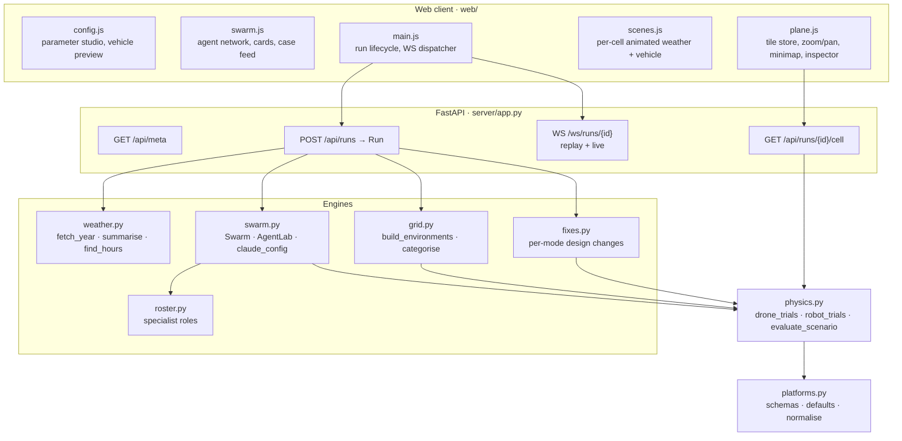
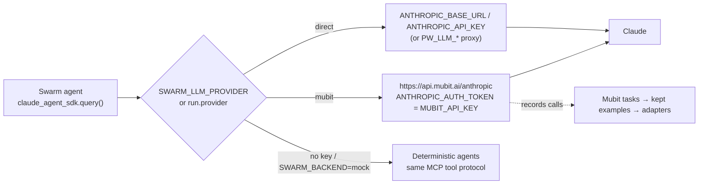

# Architecture

Swarm Proving Ground is a single FastAPI service with a static single-page front end. Every run is an in-memory `Run` object that orchestrates four engines (weather, agent swarm, environment grid, fixes) over one shared physics core and broadcasts everything it does on a replayable WebSocket event bus.

## Components

| Component | Responsibility | Key entry points |
|---|---|---|
| `platforms.py` | Drone and robot parameter schemas (type, range, unit, group), presets, normalisation of user input into a complete, valid parameter set. | `PLATFORMS`, `defaults()`, `normalise()` |
| `weather.py` | Pulls the last 12 months of hourly ERA5 data from the Open-Meteo archive for a lat/lon, caches it on disk, summarises percentiles, monthly profiles, extremes and event counts, and answers filtered hour searches for agents. Falls back to a synthetic year only when offline. | `fetch_year()`, `summarise()`, `find_hours()` |
| `physics.py` | Vectorised NumPy reduced-order models. One call evaluates `cells × trials` missions at once with randomised turbulence and component health, returning a failure-mode code per trial plus physical margins on request. | `drone_trials()`, `robot_trials()`, `evaluate_scenario()`, `summarise_modes()` |
| `roster.py` | Up to 30 specialist roles per platform. Each role has a name, a focus statement and the environmental variables it stresses. | `ROLES` |
| `swarm.py` | Runs N agents concurrently under a semaphore. Each agent gets an `AgentLab` with three in-process MCP tools and streams thoughts, tool calls and results as events. Chooses the LLM route and falls back to deterministic agents per agent on error. | `Swarm.run()`, `AgentLab`, `claude_config()` |
| `grid.py` | Synthesises an S×S plane of environments drawn from the empirical weather distribution with spatial coherence, paints agent-verified cases in as "stress districts", and categorises each cell (clear, overcast, wind, rain, storm, snow, fog, heat, freezing). | `build_environments()`, `categorise()` |
| `fixes.py` | Maps each failure mode to an engineering change (adaptive flight controller, larger battery, heater, IP upgrade, tracks, wider stance...) applied as a parameter delta. | `FIXES` |
| `app.py` | Run lifecycle, event fan-out, grid tiling and streaming, fix evaluation, report generation and the single-cell forensics endpoint. | `Run._go()`, `Run._grid()`, `Run._report()`, `Run.cell()` |

## LLM routing

- `claude_config(provider)` resolves the route per run, so one server can serve both routes side by side.
- On the Mubit route the key is sent only as `ANTHROPIC_AUTH_TOKEN` (Mubit refuses calls carrying a second key), and `CLAUDE_CODE_DISABLE_EXPERIMENTAL_BETAS=1` keeps requests within the betas the starter credit serves.
- Mubit groups calls into a task by system prompt, tools, tool choice, output format and model. The swarm therefore uses one shared system prompt per platform and puts each agent's role in the user message, so every agent feeds a single task and its adapter.

## Agent tool protocol

| Tool | Input | Output |
|---|---|---|
| `find_weather_hours` | Thresholds on gust, wind, rain, temperature, humidity, snow, pressure; sort key. | Count of matching hours and the worst examples with timestamps. |
| `run_physics_test` | A scenario: weather fields at altitude, payload, and for robots slope, terrain, friction, mud, snow depth, obstacle height. | 200-trial pass rate, failure-mode histogram, physical margins. |
| `submit_failure_case` | Title, causal mechanism, severity, mitigation, scenario. | Accepted with its 400-trial verified pass rate, or rejected if it passes more than 80%. |

The deterministic backend drives the same three tools with scripted escalation over climate percentiles, so the UI, verification gate and downstream grid are identical with or without an LLM.

## Event protocol

`WS /ws/runs/{id}` first replays every event emitted so far, then streams live. Text frames are JSON; binary frames are result tiles.

| `type` | When | Payload highlights |
|---|---|---|
| `phase` | Stage changes: `weather`, `swarm`, `grid_build`, `grid_test`, `report`, `done` | `backend`, `model`, `provider`, `roster`, cell and trial counts |
| `weather` | Weather year loaded | Climate summary, location |
| `agent` | Agent queued / running / done | Status, cases, tool calls, seconds, backend (incl. fallback), running token and cost totals |
| `agent_event` | Inside an agent | `kind`: `thinking`, `text`, `tool_call`, `tool_result`, `error` |
| `case` | A failure case passes verification | Title, mechanism, severity, mitigation, scenario, verified pass rate |
| `swarm_done` | All agents finished | Cases, physics trials, cost, tokens |
| `grid_meta` | Plane ready to stream | Size, trials, categories, failure modes, stress districts |
| `grid_progress` | Every 4 tiles | Cells tested, flights, passes, per-mode and per-category tallies |
| `fix` | Each fix re-tested | Mode, change, before → after pass rate |
| `report` | End of run | Baseline, per-fix and all-fixes pass rate, improved parameter set |
| `error` | Unrecoverable run error | Message |

### Binary tile format

Each tile covers 64×64 cells. A tile is a little-endian header `<5i>` = `MAGIC (0x50475244), tile_x, tile_y, width, height`, followed by the per-cell arrays in row-major order: environment category, pass count, dominant failure mode, stress-district id, then the quantised environment channels used by the weather view and cell scenes. The client writes tiles straight into typed-array textures, so a 1024² plane is 256 tiles and never re-sends data.

## Scale and performance

- The physics core is fully vectorised: one tile evaluates 4,096 cells × K trials in a single NumPy pass on a worker thread (`asyncio.to_thread`), keeping the event loop free for streaming.
- The default plane is 1,048,576 cells × 16 trials = 16,777,216 simulated missions per run; `GRID_REVEAL_SECONDS` paces the reveal for the live view.
- Fix evaluation re-samples a 65,536-cell subset × 8 trials per fix to keep the report under a few seconds.
- Agents run under `SWARM_CONCURRENCY` (default 30) with a per-agent timeout; a failing agent falls back to the deterministic search without stopping the swarm.

## Extension points

New environmental layers (see [ROADMAP.md](ROADMAP.md)) plug in at four seams:

1. **Data source** next to `weather.py` (for example routes, population density, airspace), summarised for the agent context.
2. **Cell channels** in `grid.py`: new per-cell fields sampled with spatial coherence.
3. **Physics terms** in `physics.py`: new failure modes and margins, vectorised over cells × trials.
4. **Agent tools and roles**: a new MCP tool in `swarm.py` and specialists in `roster.py`, with fixes in `fixes.py`.
