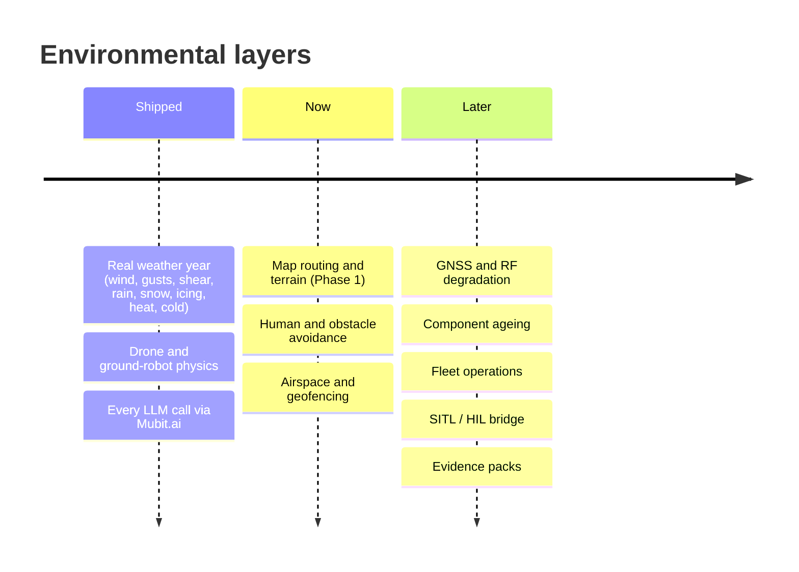

# Roadmap

Weather is the first environmental layer of Swarm Proving Ground. The platform is built so each new layer adds dimensions to every cell of the proving ground, new tools and specialists to the agent swarm, and new fixes to the design loop. All of them reuse the same agent → verify → grid → fix pipeline.

> **Status:** only the items marked *shipped* exist today. Everything else on this page is planned work and design intent.

## Shipped

| Capability | Notes |
|---|---|
| Real weather year | 8,760 hourly ERA5 records per site, altitude shear, icing, thermal and ingress models. |
| Drone and ground-robot platforms | Full parameter schemas, vectorised reduced-order physics, per-mode fixes. |
| Parallel agent swarm | Up to 30 Claude Agent SDK specialists with MCP tools and a 400-trial verification gate. |
| Million-cell proving ground | Live-streamed Monte-Carlo plane with single-cell forensics. |
| Mubit-only LLM route | Swarm and flight-ops review call Claude only through Mubit.ai (records calls, trains task adapters). |

## Next

### Map routing and terrain — shipped (Phase 1)
- **Data:** OpenStreetMap road and building footprints, digital elevation models, user-drawn mission routes.
- **Cell dimensions:** route length, elevation gain, headwind fraction per leg, distance to nearest safe landing or charging point.
- **Physics:** energy integrated along the path rather than a fixed mission time; return-to-home margin under the worst leg.
- **Agent tools:** `plan_route`, `worst_leg_for_wind`. Specialists: route energy auditor, return-to-home planner.
- **Fixes:** route re-planning, waypoint insertion, reserve policy changes.

### Human and obstacle avoidance — shipped as Phase 2 proxy
- **Data:** population density, pedestrian and vehicle traffic profiles by hour, static obstacles (trees, poles, wires).
- **Cell dimensions:** people per km², dynamic obstacle density, closing speed, visibility.
- **Physics:** perception range vs stopping distance, detection probability in rain, fog and low light, over-flight risk.
- **Agent tools:** `crowd_exposure`, `perception_check`. Specialists: crowd-safety analyst, night-perception tester.
- **Fixes:** sensor upgrades, speed caps in dense zones, corridor offsets.

### Airspace and geofencing — shipped (Phase 2)
- **Data:** no-fly zones, controlled airspace, altitude ceilings, temporary restrictions.
- **Physics:** geofence breach probability under gusts and GNSS error; altitude-ceiling conflicts with terrain.
- **Fixes:** corridor margins, altitude-hold tuning, alternative routes.

## Later

| Layer | What it adds |
|---|---|
| GNSS and RF degradation | Urban-canyon multipath, GPS denial, link loss, lost-link behaviour and failsafe timing. |
| Component ageing | Battery cycle fade, motor wear and sensor drift across service life; "pass at month 18" as well as day 1. |
| Fleet operations | Multi-vehicle missions, charging logistics, fleet availability under a year of weather. |
| SITL / HIL bridge | Export agent-verified scenarios to PX4 / ArduPilot SITL and Gazebo for high-fidelity confirmation. |
| Evidence packs | Traceable failure-case reports (scenario, weather hour, verification trials, fix and gain) for safety cases and regulatory submissions. |

## How a layer plugs in

1. **Data source**, summarised into the agent context.
2. **Cell channels** in `grid.py`, sampled with spatial coherence.
3. **Physics terms** in `physics.py`, vectorised over cells × trials, with new failure modes and margins.
4. **Agent tools and roles** in `swarm.py` / `roster.py`, plus fixes in `fixes.py`.

See [ARCHITECTURE.md](ARCHITECTURE.md#extension-points).
