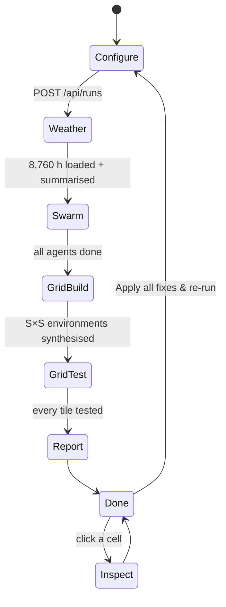
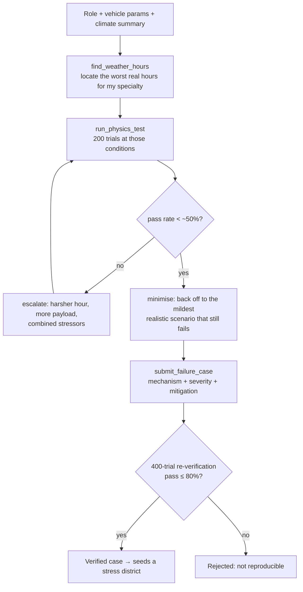

# Workflow

## 1. Run lifecycle



| Stage | What happens | Visible in the UI |
|---|---|---|
| **Configure** | Pick drone or robot, set engineering parameters, choose a site, swarm size, grid size and LLM route. Derived metrics (take-off mass, thrust/weight, endurance, gust and rain tolerance) update live. | Parameter studio, animated vehicle, derived metric cards |
| **Weather** | Fetch or load the cached 12-month hourly record for the site and compute percentiles, monthly profiles, extremes and event counts. | Climate charts and headline weather figures |
| **Swarm** | Launch N specialist agents in parallel. Each searches the weather record, runs physics tests and submits failure cases. Every case is re-verified. | Agent network with tool-call particles, one card per agent, verified-case feed, tokens, cost, elapsed time |
| **Grid build** | Synthesise the environment plane from the weather distribution and paint agent cases in as stress districts. | Phase overlay |
| **Grid test** | Monte-Carlo-test every cell in 64×64 tiles and stream results. | Plane fills live; counters for cells, flights, pass rate, failure modes |
| **Report** | Re-test each fix and all fixes combined; publish before → after pass rates. | Report panel with "Apply all fixes & re-run" |
| **Inspect** | Re-simulate a single cell with 64 fresh trials. | Cell scene, trial replay, environment, margins, failure breakdown |

## 2. Agent loop



Agents are capped at about six tool calls and must ground every scenario in real weather hours. The verification gate runs independently of the agent, so no failure enters the report on an agent's word alone.

## 3. From findings to fixes

1. Verified cases become stress districts on the plane, so the grid over-samples the conditions the swarm found dangerous.
2. Each tested cell records its dominant failure mode; the run aggregates modes across all cells and trials.
3. For the most frequent modes, `fixes.py` proposes a concrete design change.
4. Each change, and all of them combined, is re-tested on a 65,536-cell sample to report the pass-rate gain.
5. "Apply all fixes & re-run" starts a new run on the improved design, closing the design loop.

## 4. Developer workflow

```bash
uv sync                                                    # install
uv run uvicorn server.app:app --port 8811 --reload         # run with hot reload
SWARM_BACKEND=mock uv run uvicorn server.app:app --port 8811   # free, deterministic agents
```

| Task | How |
|---|---|
| Compare LLM routes | `SWARM_LLM_PROVIDER=direct|mubit uv run python scripts/bench_swarm.py --agents 8 --platform drone` (results in `data/bench/`) |
| Add a parameter | Add it to the platform schema in `platforms.py`, use it in `physics.py`; the UI renders it automatically. |
| Add a failure mode | Emit a new mode code in `physics.py`, add its label, add a fix in `fixes.py`. |
| Add an agent specialist | Add a role to `roster.py` (name, focus, stressed variables). |
| Add an environment layer | Follow the four extension seams in [ARCHITECTURE.md](ARCHITECTURE.md#extension-points). |

Weather is cached under `data/weather_cache/`, so repeated runs for the same site start immediately and work offline.
